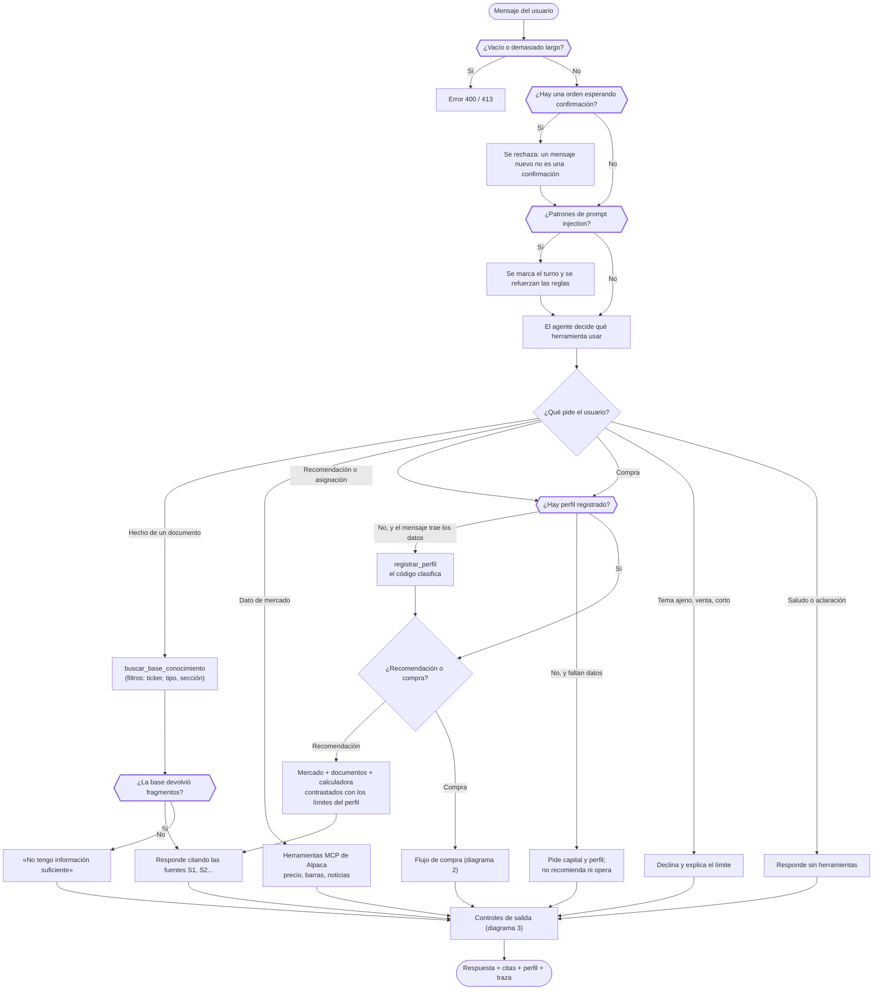
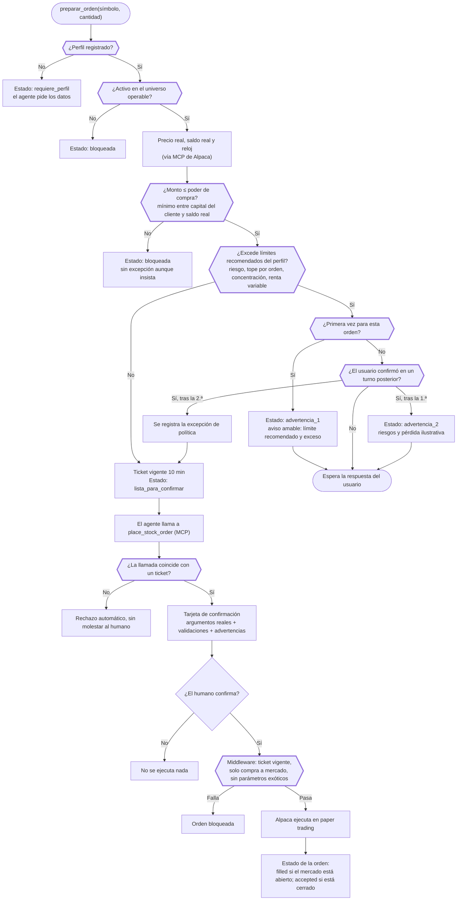

# Flujo de decisiones del agente asesor

Tres diagramas: el recorrido general de un mensaje, el detalle de una compra y los controles de salida.
Los recuadros con borde grueso son decisiones que toma el **código**; los demás, decisiones del **modelo**.

> **Versión editable:** [`diagramas.drawio`](diagramas.drawio) contiene estos diagramas y el de arquitectura en
> formato nativo de draw.io (cuatro páginas). Ábrelo en [app.diagrams.net](https://app.diagrams.net) con *Archivo > Abrir
> desde > Dispositivo*, o con draw.io Desktop. Se regenera con `python -m scripts.build_drawio`.

## 1. Recorrido de un mensaje

## 2. Flujo de compra

Puntos que conviene recordar:

- El modelo no puede avanzar dos etapas de advertencia en el mismo turno: cada avance exige un mensaje posterior del
  usuario.
- El framework impide que los argumentos cambien después de la aprobación: lo que el humano confirma es exactamente
  lo que se ejecuta.
- El agente no tiene herramientas de venta, cancelación, opciones ni cripto: no están en la lista blanca.

## 3. Controles de salida

```mermaid
flowchart LR
    R(["Texto del modelo"]) --> C1{{"¿Contiene el canario del prompt?"}}
    C1 -- "Sí" --> X1["Se reemplaza por una negativa<br/>y se marca fuga bloqueada"]
    C1 -- "No" --> C2{{"¿Cada cita S1, S2... existe en la sesión?"}}
    X1 --> C2
    C2 -- "No" --> X2["Se elimina la cita inválida y se marca"]
    C2 -- "Sí" --> C3
    X2 --> C3{{"¿Consultó la base, no obtuvo nada<br/>y no usó otra fuente de datos?"}}
    C3 -- "Sí" --> X3["Se antepone<br/>«No tengo información suficiente»"]
    C3 -- "No" --> F
    X3 --> F["Lista de fuentes armada desde la metadata,<br/>nunca desde URLs del modelo"]
    F --> UI(["Interfaz: HTML saneado, chips de citas, traza"])

    classDef code stroke-width:3px;
    class C1,C2,C3 code;
```

